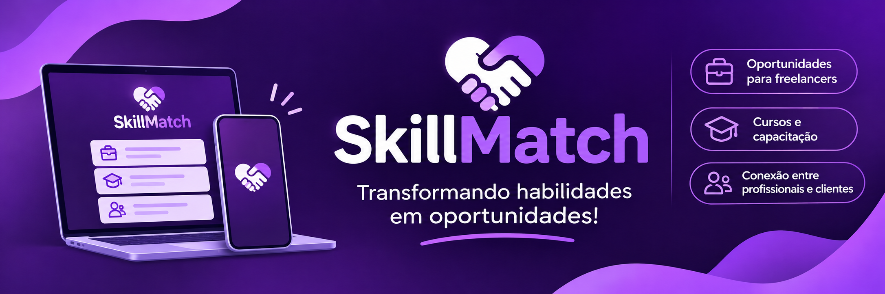
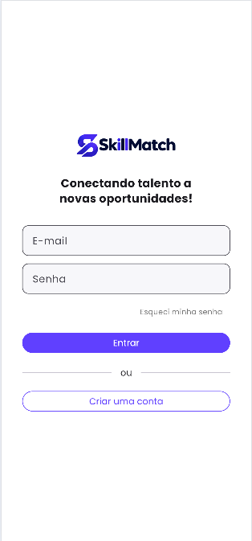
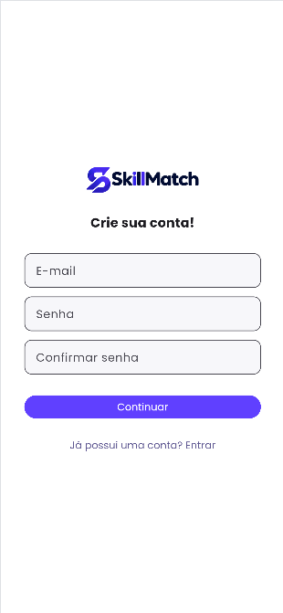
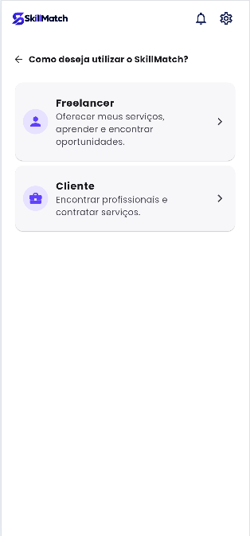
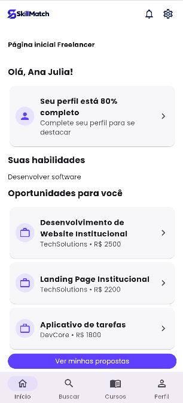
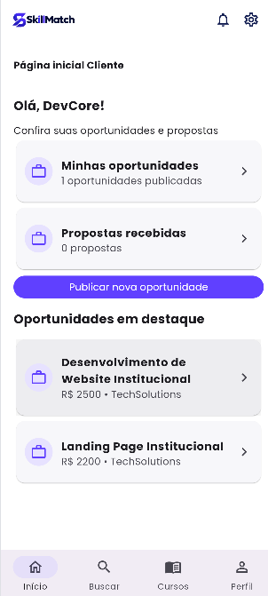
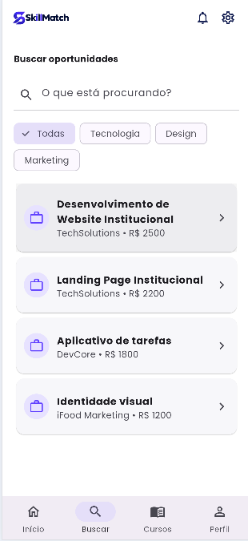
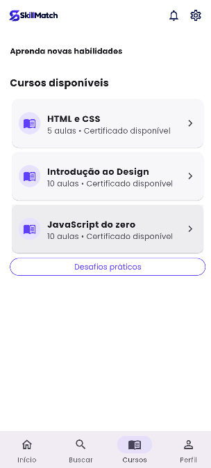

<div align="center">



# 💜 SkillMatch
### Transformando habilidades em oportunidades!


**Projeto acadêmico • Universidade de Mogi das Cruzes (UMC)**

</div>

---

## 📖 Sobre o projeto

O **SkillMatch** é um aplicativo acadêmico desenvolvido com **Flutter e Dart** para conectar **freelancers**, especialmente profissionais em início de carreira, a **clientes e oportunidades de trabalho**.

A plataforma reúne divulgação de habilidades, perfis profissionais, oportunidades, propostas e conteúdos de capacitação em uma interface intuitiva. O aplicativo possui fluxos distintos para **Freelancer** e **Cliente**.

## 🎯 Objetivos

- Facilitar o acesso às primeiras oportunidades profissionais.
- Dar visibilidade às habilidades e aos serviços de freelancers.
- Aproximar clientes de profissionais disponíveis.
- Incentivar a capacitação e a construção de portfólio.
- Tornar mais simples o acompanhamento de oportunidades e propostas.

## ✨ Funcionalidades

| 👩‍💻 Freelancer | 🧑‍💼 Cliente |
|---|---|
| Cadastro e login local | Cadastro e login local |
| Perfil profissional | Perfil de cliente |
| Busca de oportunidades | Publicação de oportunidades |
| Visualização de detalhes | Visualização das oportunidades publicadas |
| Envio e acompanhamento de propostas | Consulta de propostas recebidas |
| Acesso a cursos e portfólio | Exclusão de oportunidades |

**Também inclui:** navegação entre **Início, Buscar, Cursos e Perfil**, além de telas de notificações e configurações.

## 📱 Capturas de tela

As imagens abaixo são capturas incluídas no próprio repositório, em `docs/prints/`.

<div align="center">

### 🔐 Acesso e cadastro

| Login | Cadastro | Continuação do cadastro |
|:---:|:---:|:---:|
|  |  |  |

### 🏠 Páginas iniciais

| Início — Freelancer | Início — Cliente |
|:---:|:---:|
|  |  |

### 💼 Oportunidades e capacitação

| Oportunidades | Cursos |
|:---:|:---:|
|  |  |

</div>

## 🛠️ Tecnologias utilizadas

- **Flutter e Dart:** desenvolvimento da aplicação e da interface.
- **Material Design 3:** componentes visuais.
- **SQLite (`sqflite`):** armazenamento local de dados da aplicação.
- **`sqflite_common_ffi_web`:** suporte ao SQLite na versão web.
- **`shared_preferences`:** armazenamento local de informações de contas e sessões de demonstração.
- **`crypto`:** geração de hashes de senha para as contas locais demonstrativas.
- **Fonte Poppins:** tipografia da interface.

## 🗂️ Estrutura do projeto

```text
skill_match/
├── assets/
│   ├── fonts/              # Fontes Poppins
│   └── img/                # Logotipo
├── docs/
│   └── prints/             # Banner e capturas de tela
├── lib/
│   ├── controller/         # Apoio à navegação
│   ├── data/               # Dados de demonstração
│   ├── models/             # Modelos de dados
│   ├── services/           # Persistência e contas locais
│   ├── theme/              # Tema e cores
│   ├── view/               # Telas e componentes
│   └── main.dart           # Entrada do aplicativo
├── test/                   # Testes
└── pubspec.yaml            # Dependências e configurações
```

## 🚀 Como executar

**Pré-requisitos:** Flutter SDK instalado e navegador Chrome disponível.

1. Clone o repositório:

```bash
git clone https://github.com/anamonteiro1006/skillmatch.git
```

2. Entre na pasta do projeto:

```bash
cd skillmatch
```

> Caso o projeto esteja dentro de uma subpasta chamada `skill_match`, entre nela antes de executar os comandos seguintes.

3. Instale as dependências e inicie o aplicativo:

```bash
flutter pub get
flutter run -d chrome
```

4. Para verificar a qualidade do código e executar os testes:

```bash
flutter analyze
flutter test
```

## 🔄 Fluxos de utilização

1. **Cadastro:** criar conta e escolher entre Freelancer e Cliente.
2. **Cliente:** acessar o perfil, publicar uma oportunidade e consultar as propostas.
3. **Freelancer:** entrar na conta, buscar oportunidades e enviar uma proposta.
4. **Acompanhamento:** retornar à conta do cliente para visualizar a proposta recebida.
5. **Gerenciamento:** excluir oportunidades e utilizar as demais áreas do aplicativo.

## 💾 Armazenamento local

O projeto utiliza **SQLite** para persistir dados da aplicação, como oportunidades e propostas, e **SharedPreferences** para informações locais de contas e sessões de demonstração. Assim, dados podem permanecer disponíveis após fechar e reabrir o aplicativo no mesmo ambiente.

> **Importante:** trata-se de um projeto acadêmico. O gerenciamento de contas é local e demonstrativo, não substitui um serviço de autenticação de produção. Os dados não são sincronizados automaticamente entre navegadores ou dispositivos.

## 🌍 Impacto social

O SkillMatch se relaciona aos Objetivos de Desenvolvimento Sustentável (ODS):

- **ODS 8 — Trabalho Decente e Crescimento Econômico:** incentivo ao acesso ao trabalho e à geração de renda.
- **ODS 10 — Redução das Desigualdades:** ampliação das oportunidades para profissionais iniciantes.

## 👥 Equipe

- **Ana Júlia Monteiro Lemes**
- **Júlio Félix Quintero de Assis**
- **Thamiris Bernal Molina**

**Instituição:** Universidade de Mogi das Cruzes (UMC).

---

<div align="center">

### 💜 SkillMatch
**Conectando talentos a novas oportunidades.**

Desenvolvido para fins acadêmicos na Universidade de Mogi das Cruzes.

</div>
